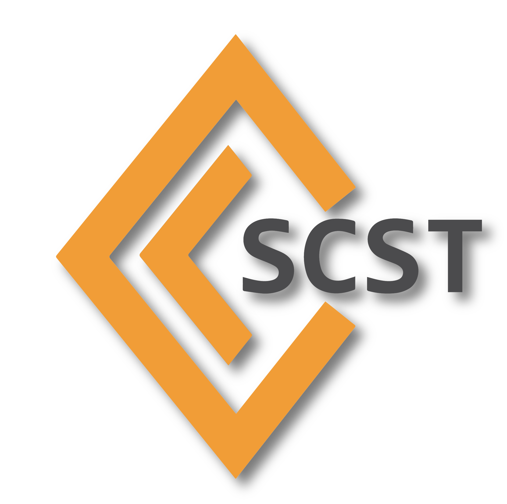

<h1 align="center">
  
</h1>

# Overview

This is the source code repository of the SCST project. SCST is a collection
of Linux kernel drivers that implement SCSI target functionality. The SCST
project includes:

1. The SCST core in the scst/ subdirectory.
2. A tool for loading, saving and modifying the SCST configuration in
   directory scstadmin/.
3. Several SCSI target drivers in the directories iscsi-scst/,
   qla2x00t-32gbit/, qla2x00t/, srpt/, scst_local/ and fcst/.
4. User space programs in the usr/ subdirectory, e.g. fileio_tgt.
5. Various documentation in the doc/ subdirectory.

## Documentation

- [Building and installing SCST](INSTALL.md).
- Build options: [Clang](README.clang),
  [cross-compilation](README.cross-compilation), and
  [kernel module signing](README.module-signing).
- [Configuration and administration](scstadmin/README): targets, devices,
  LUNs, and `/etc/scst.conf`.
- [Core and device handlers](scst/README): operating modes, module parameters,
  and sysfs configuration.
- Target drivers: [iSCSI](iscsi-scst/README), [iSER](iscsi-scst/README.iser),
  [QLogic Fibre Channel](qla2x00t-32gbit/qla2x00-target/README),
  [SRP](srpt/README), [FCoE](fcst/README), and
  [local loopback](scst_local/README).
- [Performance tuning](README.performance).
- [Clustered persistent reservations](scst/README.dlm): synchronization
  through DLM.
- [T10 protection information](scst/T10-PI): data integrity modes and
  configuration.
- Developer references: [architecture](doc/scst_pg.sgml) and
  [userspace handler interface](doc/scst_user_spec.sgml) (SGML sources), and
  [sysfs interface rules](scst/SysfsRules).
- [Contributing](CONTRIBUTING.md): code style, commit conventions, local
  checks, and guides to KUnit and component testing.

## Current master packages

Prebuilt x86_64 packages from the latest successfully published `master`
build are available in the rolling
[`master-rpm` prerelease](https://github.com/SCST-project/scst/releases/tag/master-rpm).
These are development snapshots, not SCST releases.

The snapshot contains RPM bundles for selected Rocky Linux and Oracle Linux
UEK kernels. It also contains Ubuntu LTS bundles with `scst-dkms`, `scstadmin`
and `iscsi-scst` binary packages and their Debian source package files. Exact
distribution releases and RPM kernel versions are included in the asset names.
Every `.tar.gz` bundle has a matching `.sha256` file. The complete snapshot is
replaced after each successful package workflow for the current `master`
commit.

## QLogic target driver

Two QLogic target drivers are included in the SCST project.

The default driver is located in the qla2x00t-32gbit directory. It is the
newer one.

May anyone wish to switch back to the older driver that only supported up to
16 Gb/s adapters, it is located in qla2x00t directory. To make use of the
older driver build scst with environment variable `QLA_32GBIT=no` set.

Vladislav Bolkhovitin <vst@vlnb.net>, http://scst.sourceforge.net

## Sourceforge achievements

